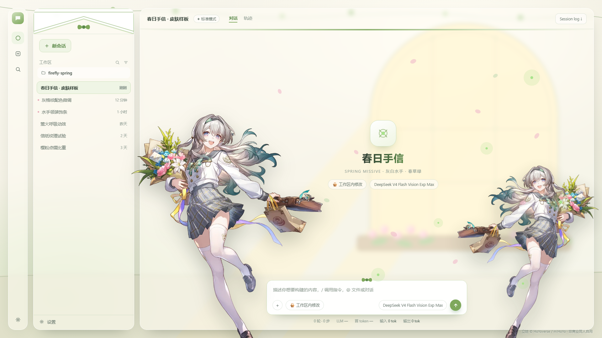

# DSH × 流萤「春日手信」皮肤

给 [DeepSeek Harness](https://github.com/deepseek-ai/deepseek-harness) Web GUI 做的一套
《崩坏：星穹铁道》流萤 **3.4 版本时装「春日手信 / Spring Missive」** 主题皮肤。

A Firefly "Spring Missive" theme skin for the DeepSeek Harness web GUI.



## 这是什么 / 现在能做什么

形态参考了社区里最热门的
[`@smalltailqwq/dsh-client-ui-skin-maid-atelier`](https://www.npmjs.com/package/@smalltailqwq/dsh-client-ui-skin-maid-atelier)：

```
全幅背景插画  →  半透明玻璃面板  →  立绘压在界面之上  →  花瓣 / 萤火天气层
```

| | 状态 |
|---|---|
| **静态预览样板**（本仓库当前内容） | ✅ 可用：克隆下来直接打开 `index.html` 就能看 |
| **可一键安装的 DSH 插件** | 🚧 计划中：会按 `@deepseek-ai/dsh-client-ui-theme` 的令牌规范打包成 bundle |

> ⚠️ 现在这个仓库是**视觉样板**，不是能 `dsh plugin add` 的插件。
> 你可以拿它当配色参考、改自己的主题，或者等插件版。

## 快速预览

**方式一 · 直接打开**

```bash
git clone https://github.com/kang200862/dsh-firefly-spring-skin.git
cd dsh-firefly-spring-skin
# 双击 index.html，或：
start index.html          # Windows
open  index.html          # macOS
xdg-open index.html       # Linux
```

**方式二 · GitHub Pages**

仓库设置里把 Pages 指向 `main` 分支根目录，之后访问
`https://kang200862.github.io/dsh-firefly-spring-skin/` 即可在线看。
（页面路径全是相对的，Pages 下能正常工作。）

> 页面按 **1920×1080** 设计。窗口对不上时用浏览器缩放，或用
> `msedge --headless=new --window-size=1920,1080 --screenshot=out.png index.html` 出图。

## 文件说明

| 文件 | 说明 |
|---|---|
| `index.html` | 样板页面，双击即可打开 |
| `skin.css` | 全部样式与设计令牌（改配色只动这里） |
| `skin.js` | 界面标记与原创 SVG 背景场景 |
| `tokens.css` | 只抽出设计令牌，方便你直接抄进自己的主题 |
| `assets/` | 人物立绘（第三方素材，见 [NOTICE.md](NOTICE.md)） |
| `preview/` | 渲染好的预览图 |

## 配色

取样自官方立绘，不是凭感觉配的：

| 用途 | 令牌 | 值 | 依据 |
|---|---|---|---|
| 页面底 | `--canvas` | `#F2EFE3` | 宣传图的奶油米白 |
| 面板 | `--surface` | `rgba(255,253,247,.55)` | 玻璃质感，透出背景 |
| 春草绿（领结 / 主按钮） | `--accent` | `#7FA85C` | 立绘领结 |
| 深春绿 | `--accent-strong` | `#5C8A4A` | |
| 嫩芽绿（描边） | `--accent-soft` | `#CFE0BC` | |
| 正文 | `--ink` | `#2C3A31` | |
| 樱粉（点缀） | `--sakura` | `#E8A9B8` | 花束与花瓣 |
| 萤火 | `--glow` | `#A9E38C` | 「流萤」的萤光 |
| 灰格纹 | `--plaid-a/b` | `#8E9691` / `#C3C8C0` | 百褶裙 |

## 自定义

### 换人物立绘

覆盖 `assets/` 里两个同名文件即可，**代码不用改**：

- `character-left.webp` —— 左侧大立绘
- `character-right.webp` —— 右侧小立绘

透明底的 PNG / WebP 效果最好。右侧默认是左侧的镜像；如果你有**第二张不同姿势**的立绘，
换掉 `character-right.webp`，再把 `skin.css` 里 `.char.right` 的 `transform: scaleX(-1)` 删掉。

### 换配色

改 `skin.css` 顶部 `:root` 那一段。三个关键项：

- `--surface` 的透明度决定背景透出多少
- `--blur` 决定背景的柔焦程度（想更清晰就调小）
- `--accent` 决定强调色

### 背景

`skin.js` 里的 `ART_SCENE` 是**完全原创**的 SVG（拱窗 + 窗台花箱 + 光束 + 垂藤 + 地面），
可以随便改或整个删掉换成你自己的图。

## 版权与署名

- **代码与原创图形**（`skin.css` / `skin.js` / 原创 SVG 场景）：MIT，见 [LICENSE](LICENSE)。
- **`assets/` 下的人物立绘**：© HoYoverse / miHoYo，**不在 MIT 授权范围内**。
  按官方同人指引**仅限非商业同人使用，需署名**。已在本页右下角与 [NOTICE.md](NOTICE.md) 署名。
- 想彻底避开第三方素材：把 `assets/` 换成你自己的图，其余部分都是原创。
  详细步骤见 [NOTICE.md](NOTICE.md)。

## 路线图

- [x] 视觉样板（背景 + 立绘 + 玻璃面板 + 装饰）
- [ ] 打包成可安装的 DSH bundle（`dsh plugin add`）
- [ ] 把配色映射到 `--dsw-alias-*` 官方令牌，而不是覆盖具体元素
- [ ] 「设置 → 外观」里能切主题、记忆选择
- [ ] 深色版「夜萤」

## 已知取舍

- 是**静态复刻**：切不了主题、不持久化、没有动效。
- 右侧立绘是左侧的镜像（手上只有一张透明立绘）。
- 背景是**柔焦**的，因为面板带了 `backdrop-filter`。
