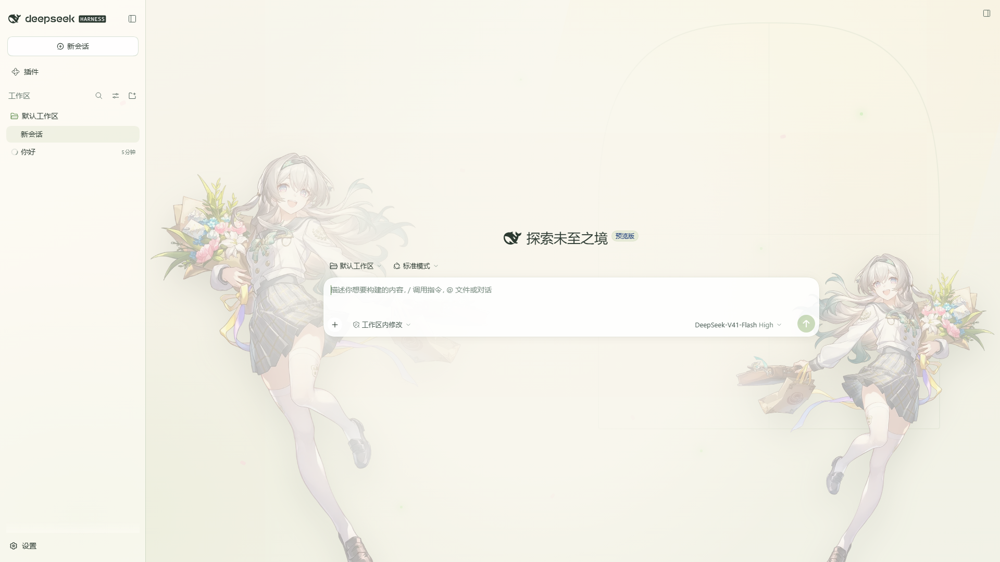
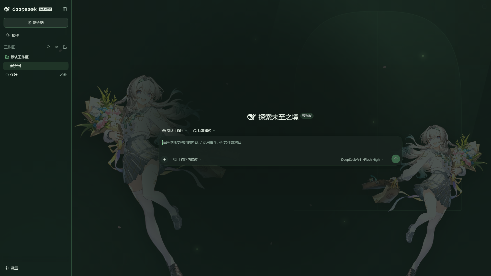

# DSH × 流萤「春日手信」皮肤

给 [DeepSeek Harness](https://github.com/deepseek-ai/deepseek-harness) Web GUI 做的一套
《崩坏：星穹铁道》流萤 **3.4 版本时装「春日手信 / Spring Missive」** 主题皮肤。

A Firefly "Spring Missive" theme skin for the DeepSeek Harness web GUI.

**浅色 · 春信（晨光）**



**深色 · 夜萤（深林）**



> 上图是**真实 DSH 界面**（不是效果图）—— 用无头浏览器把插件注入到运行中的 DSH 页面里截的。
>
> 仓库里另有一份**不装插件也能看的静态样板**：<https://kang200862.github.io/dsh-firefly-spring-skin/>
> （`index.html` + `skin.css` + `skin.js`，是插件成型前的视觉稿）。

## 安装

插件市场的「添加插件」支持 Git 地址，直接粘这一行：

```
github:kang200862/dsh-firefly-spring-skin
```

或者命令行：

```bash
dsh plugin --profile <你的profile名> add github:kang200862/dsh-firefly-spring-skin
```

装完**刷新页面**即可。想改设置或卸载：设置 → 插件 → 本插件。

> 计划发布 npm 包；在那之前 Git 地址就是安装方式。

## 它做了什么

形态参考社区里最热门的
[`@smalltailqwq/dsh-client-ui-skin-maid-atelier`](https://www.npmjs.com/package/@smalltailqwq/dsh-client-ui-skin-maid-atelier)：

```
春日橱窗背景  →  半透明玻璃面板  →  桌面立绘  →  花瓣 / 萤火
```

| | 说明 |
|---|---|
| **配色** | 覆盖 87 个 `--dsw-alias-*` 官方令牌，明暗两套。**不写死元素样式**，DSH 换版不会把皮肤改坏 |
| **背景** | 春日橱窗：拱窗线稿 + 光束 + 地面 + 飘落花瓣 + 萤火 |
| **立绘** | 流萤「春日手信」全身立绘，左侧大、右侧小（镜像） |
| **聚光遮罩** | 中央内容列加一层柔光罩，保证文字对比度；两侧留给立绘 |
| **设置页** | 「设置 → 春日手信」两个开关：启用皮肤、显示桌面立绘 |

设置项（`设置 → 春日手信`）：

- **启用「春日手信」皮肤** —— 总开关，关掉即完全还原
- **显示桌面立绘** —— 只保留配色与背景，去掉人物

两个选择都记在 `localStorage`，刷新后保持。

## 配色

取样自官方立绘，不是凭感觉配的：

| 用途 | 令牌 | 值 |
|---|---|---|
| 春草绿（领结 / 主按钮） | `--dsw-alias-brand-primary` | `#7FA85C` |
| 正文 | `--dsw-alias-label-primary` | `#2C3A31` |
| 页面底 / 面板 | `--dsw-alias-bg-base` / `-layer-*` | 半透明奶油白 |
| 樱粉（点缀） | `--dsw-alias-markdown-tag` | `#E8A9B8` |
| 萤火（深色强调） | `--dsw-alias-brand-primary`（dark） | `#8FE0A0` |

完整的令牌表在 [`src/client.js`](src/client.js) 的 `LIGHT` / `DARK` 两处。
只想拿配色、不想装插件的，可以抄 [`tokens.css`](tokens.css)。

## 仓库里有什么

| 路径 | 说明 |
|---|---|
| `lib/index.js` `lib/client.js` | **插件构建产物**（client.js 已内联立绘，约 300 KB） |
| `src/host.js` `src/client.js` | 插件源码 —— 要改就改这里 |
| `scripts/build.mjs` | 构建：`src/` → `lib/`，把立绘内联成 data URI |
| `scripts/preview-live.mjs` | 真机验证：把插件注入正在运行的 DSH 并截图（不装插件、不碰 profile） |
| `index.html` `skin.css` `skin.js` | **静态样板**（GitHub Pages 用），不是插件 |
| `tokens.css` | 抽出的设计令牌 |
| `assets/` | 人物立绘（第三方素材，见 [NOTICE.md](NOTICE.md)） |
| `preview/` | 截图 |

改完源码记得重新构建：

```bash
node scripts/build.mjs
```

## 真机验证

不装插件也能看效果 —— 它会打开你正在运行的 DSH 页面，把 `lib/client.js` 注入进去截图：

```bash
node scripts/preview-live.mjs "http://127.0.0.1:<port>/?token=<token>" preview/live.png 1920 1080 dark
```

最后一个参数可以强制 `light` / `dark`，用来分别验证两套令牌。

## 版权与署名

- **代码与原创图形**（`src/` `lib/` `skin.css` `skin.js` 的原创 SVG 场景）：MIT，见 [LICENSE](LICENSE)。
- **`assets/` 下的人物立绘**：© HoYoverse / miHoYo，**不在 MIT 授权范围内**，
  按官方同人指引仅限非商业同人使用、需署名。详见 [NOTICE.md](NOTICE.md)，
  里面也写了怎么一条命令把立绘换成你自己的图。

## 已知取舍

- 立绘在界面**之下**（不是压在最上层），所以它永远不会挡住按钮和文字 —— 代价是比女仆皮肤那种「立绘压在 UI 上」淡一些。
- 右侧立绘是左侧的镜像（手上只有一张透明立绘）。
- 立绘按视口宽高比定位，超宽屏或窄窗口下位置会变，可用设置里的开关直接关掉人物。
- 只做了 Web 端；DSH Desktop 未实测。

## 路线图

- [x] 静态样板（背景 + 立绘 + 玻璃面板）
- [x] 可安装的 DSH bundle + 设置页 + 明暗两套令牌
- [ ] 发布到 npm
- [ ] 提 PR 到 [awesome-dsh-plugin](https://github.com/awesome-dsh-plugin/awesome-dsh-plugin) 目录，让它在插件市场里能被搜到
- [ ] 第二张不同姿势的立绘（替掉右侧镜像）
